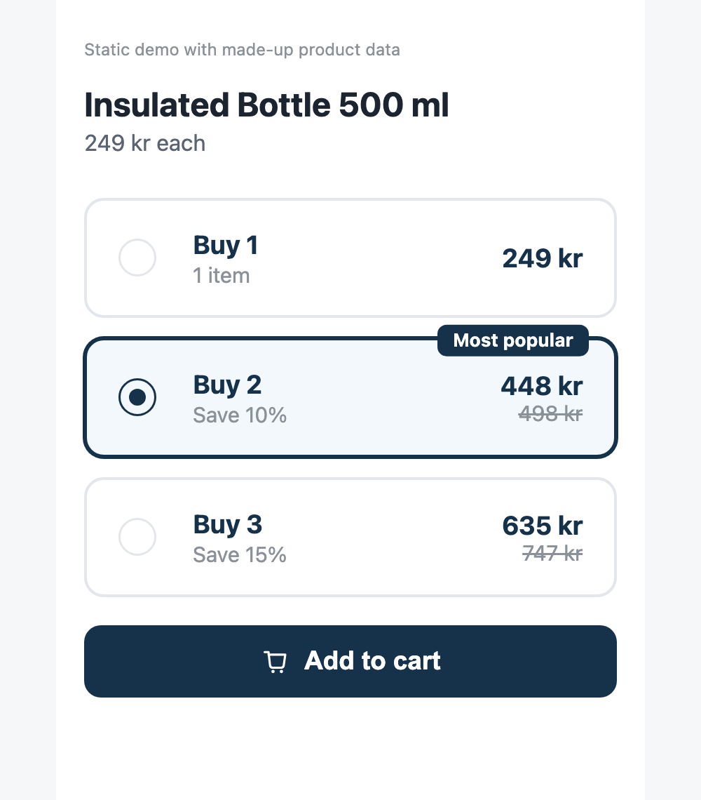
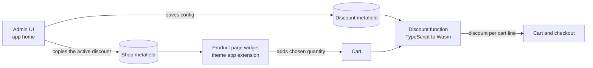

# Shopify volume discounts

A small Shopify app for "buy more, save more" offers. It shows the offers as selectable cards on the product page and applies the matching discount in the cart and at checkout.

It runs entirely on Shopify: there is no server to host and no database.

<p align="center">
  
</p>

## Why I built it

I built this for my own D2C store, where quantity offers were a central part of the product page. I wanted three things at once:

- **Control over the offer itself.** Which quantity is preselected, what the badge says, and whether the strikethrough price is based on the regular price or the compare-at price are all pricing decisions, and I wanted to change them without touching code.
- **The price on the product page to be the price at checkout.** Both are calculated from the same saved configuration.
- **No running costs or moving parts.** Everything is stored in Shopify metafields and executed by Shopify.

## How it works



1. **The merchant sets up offers in the admin UI**: quantity, discount (percentage or fixed amount), title, subtitle, badge and which offer is preselected.
2. **The configuration is saved on the discount**, where the function reads it. The app also copies the configuration of the active discount to a metafield on the shop, where the storefront can read it.
3. **The widget renders the offers on the product page.** Prices are rendered server-side in Liquid and recalculated in the browser when the customer switches variant. The button adds the chosen quantity through the Ajax Cart API.
4. **The Shopify Function applies the discount.** For each cart line it picks the highest tier the quantity reaches, and every qualifying line gets its discount. The function decides the price; the widget only presents it.

Colours, sizes and what happens after add-to-cart are block settings in the theme editor, so they can be adjusted with live preview.

## Keeping the product page and checkout in step

The widget and the function calculate the price separately, so a few rules keep them from disagreeing:

- **Only one volume discount can be active at a time.** The app refuses to create or activate a second one. If two are active anyway, for example after a change on Shopify's own discount page, the widget shows no offer and the app shows a warning.
- **The widget shows the active discount.** With no discount active it shows nothing, rather than an offer that checkout would not honour.
- **Fixed amounts only apply in the shop's currency.** Shopify reads a fixed amount in the currency the customer pays in, so 50 kronor would become 50 euros in the Netherlands. The function therefore skips fixed amounts for customers paying in another currency, and the widget hides the offer for them. Percentages work in every currency.
- **Offers are edited in one place.** An earlier version also had a settings form on Shopify's discount page, but a change made there reached checkout without reaching the product page, so I removed it.

## What is in the repository

| Path | What it is |
|---|---|
| [`extensions/volume-discount`](extensions/volume-discount) | The Shopify Function that calculates the discount, with unit tests |
| [`extensions/bundle-widget`](extensions/bundle-widget) | Theme app extension: the Liquid block, stylesheet and script for the product page |
| [`extensions/admin-home`](extensions/admin-home) | Admin UI for creating, editing, pausing and deleting discounts (Preact and Polaris web components) |
| [`tests`](tests) | Unit tests for the widget's price calculation and money formatting |
| [`demo`](demo) | A static page that runs the real widget stylesheet and script with made-up data |

## Try it

The widget can be tried without a Shopify store. Open `demo/index.html` in a browser.

To run the checks:

```shell
npm install
npm run typegen
npm run lint
npm run typecheck
npm test
```

To run the whole app you need a Shopify Partner account, a development store and the [Shopify CLI](https://shopify.dev/docs/apps/tools/cli):

```shell
npm install
npx shopify app config link
npx shopify app dev
```

`client_id` in `shopify.app.toml` is left empty on purpose. `shopify app config link` fills it in for your own app.

## Tests

The discount function is a pure function from cart and configuration to discount operations, so it is tested without Shopify. The tests cover:

- an empty cart, a missing configuration and invalid JSON
- quantities below the lowest tier
- picking the highest tier reached
- several cart lines where only some qualify, and two different products that both qualify
- percentage and fixed-amount discounts, and fixed amounts in a currency other than the shop's
- both configuration formats the function accepts

The rules for which discount the widget shows, and when a discount may be activated, are pure functions with their own tests.

The widget's price calculation is tested the same way: percentage and fixed discounts, rounding, when a strikethrough price is shown, and money formatting for the shop formats Shopify uses.

Linting, type checking and all tests run on every push. The admin UI and the theme block need a Shopify store to run, so they are not covered by automated tests.

## Limitations

- **Tiers are counted per cart line.** Two different variants of the same product do not add up to a "Buy 2" tier.
- **One active volume discount at a time.** Different offers for different products are not supported.
- **Fixed amounts only reach customers who pay in the shop's currency.** Use percentages for other markets.
- **Changes made outside the app reach the widget the next time the app is opened.** That applies to pausing, activating or deleting a discount on Shopify's own discount page.
- **Strikethrough prices follow the compare-at price in Shopify.** In the EU, a price reduction has to be shown against the lowest price of the last 30 days, and the app does not check that. The default setting compares against the regular price for the same quantity, which is a quantity discount rather than a price reduction.
- **The cart drawer integration targets Shopify's Horizon themes.** On other themes the widget sends the customer to the cart page instead.
- **The admin UI is in English only.**

## How it was built

I am not a software engineer by trade. I wrote this with [Claude Code](https://claude.com/claude-code): I decided what the app should do, tested it in my store and worked through the edge cases that showed up there, and the AI wrote most of the code.

This public version is a cleaned-up copy of the app I ran. Store-specific names are removed and the texts are in English. Since then I have changed how several cart lines, several discounts and other currencies are handled. Those changes are covered by tests but have not run in a store.

## License

[MIT](LICENSE)
